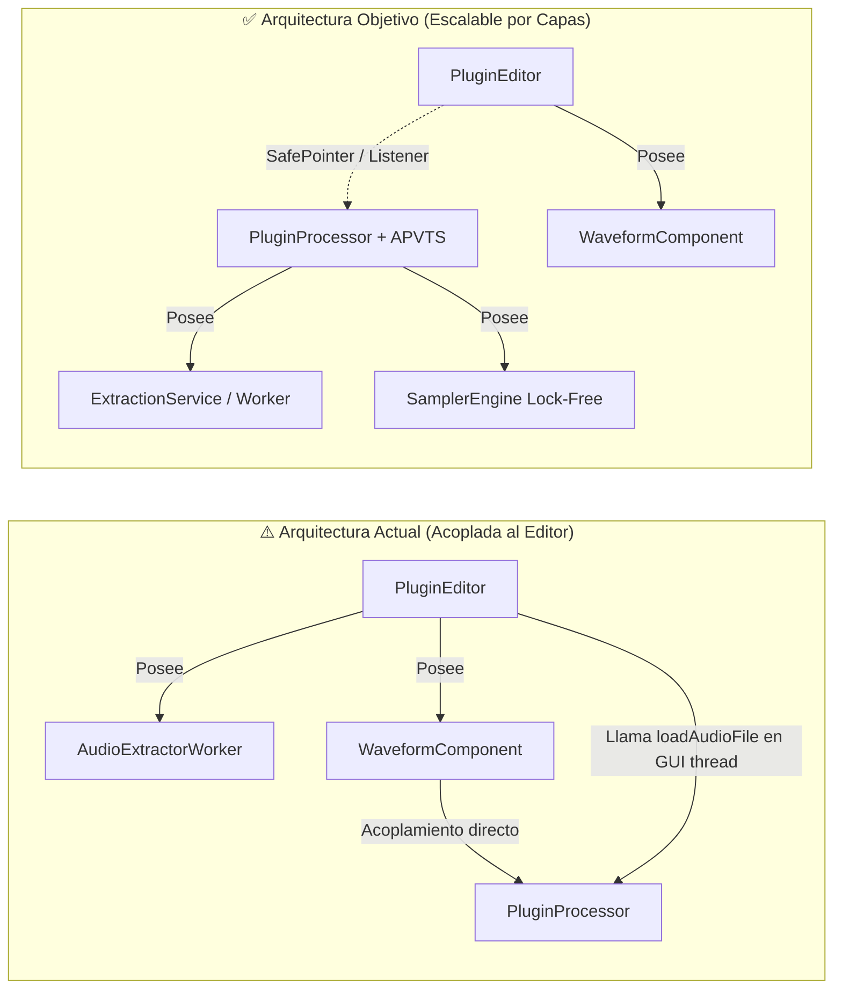

# 🔍 Auditoría Exhaustiva de Arquitectura y Calidad de Código — ClipSampler10

**Fecha de Auditoría:** 21 de Octubre de 2026  
**Rol:** Principal Software Architect (Staff Software Engineer) & Code Quality Auditor  
**Proyecto:** `ClipSampler10` (VST3 / AAX Virtual Instrument Audio Plugin — JUCE 8 + CMake)  
**Objetivo:** Diagnóstico pre-producción para empaquetado multiplataforma (`.exe` Windows / `.pkg` macOS) y preparación de la base arquitectónica para futuras expansiones de funcionalidades.

---

## 📊 Resumen Ejecutivo

El proyecto **ClipSampler10** cuenta con una base funcional sólida y bien enfocada en su propuesta de valor (captura de fragmentos de 10 segundos desde YouTube sincronizados al Sample Rate del DAW, reproducción polifónica MIDI con `juce::Synthesiser` y exportación/arrastre directo al timeline del DAW).

Sin embargo, antes de pasar a **producción comercial** y de **escalar el plugin con nuevas opciones**, la auditoría ha detectado **6 problemas críticos (🔴)** que pueden provocar cierres inesperados (*crashes* por *Use-After-Free*) en el DAW, bloqueos del hilo de tiempo real de audio (*audio dropouts*), procesos `ffmpeg` huérfanos en Windows y fallos silenciosos en los instaladores `.exe` y `.pkg`.

A continuación se detalla el informe técnico estructurado en los **6 puntos solicitados**.

---

## 1. 📁 Auditoría de Estructura y Cantidad de Carpetas

### 1.1. Análisis del Árbol de Directorios Actual

```text
ClipSampler10/
├── .github/workflows/build.yml        # CI/CD GitHub Actions (Windows & macOS)
├── Source/                            # 8 archivos planos (.h / .cpp) mezclando DSP, UI y Worker
│   ├── AudioExtractorWorker.h / .cpp
│   ├── PluginEditor.h / .cpp
│   ├── PluginProcessor.h / .cpp
│   └── WaveformComponent.h / .cpp
├── installer/
│   ├── Output/                        # ⚠️ Carpeta vacía en disco
│   ├── build_pkg.sh                   # Script de empaquetado macOS
│   ├── license.txt                    # EULA
│   ├── macos_distribution.xml         # Definición de componentes productbuild
│   └── windows_installer.iss          # Script Inno Setup Windows
├── resources/
│   └── README.md                      # ⚠️ Documenta resources/tools/, pero no existe
├── build/                             # Artefactos locales de compilación CMake (ignorado)
├── dist_windows/                      # Salida local del instalador .exe (ignorado)
├── .gitignore
├── build_windows.ps1                  # Script de compilación Windows en raíz
├── CMakeLists.txt
├── documentacion.md                   # Documentación técnica
└── README.md                          # Resumen del proyecto
```

### 1.2. ¿Existe Sobreingeniería o Falta de Modularidad?

* **No hay sobreingeniería de carpetas**, pero **sí falta modularidad interna en `Source/` de cara al futuro**. Actualmente los 8 archivos conviven en un único nivel plano dentro de [`Source/`](file:///c:/Users/joncl/Downloads/Plugin/Source). Para el MVP actual es manejable, pero dado que planeas **agregar más opciones en el futuro** (nuevos controles de sampler, efectos DSP, envolventes ADSR, pitch/time-stretching, historial de muestras, presets), mantener todo plano en `Source/` convertirá a `PluginProcessor` y `PluginEditor` en *God Objects* difíciles de mantener.
* **Asimetría en scripts de construcción:** [`build_windows.ps1`](file:///c:/Users/joncl/Downloads/Plugin/build_windows.ps1) está en la raíz del proyecto, mientras que su contraparte de macOS [`installer/build_pkg.sh`](file:///c:/Users/joncl/Downloads/Plugin/installer/build_pkg.sh) está dentro de `installer/`.

### 1.3. Carpetas Vacías, Archivos Huérfanos, Código Muerto y Duplicidades

1. **Carpeta vacía e inconsistencia de salida (`installer/Output/`):**
   * La carpeta [`installer/Output/`](file:///c:/Users/joncl/Downloads/Plugin/installer/Output) está vacía. Existe porque [`.github/workflows/build.yml`](file:///c:/Users/joncl/Downloads/Plugin/.github/workflows/build.yml#L42-L48) ejecuta `iscc installer/windows_installer.iss` usando la salida por defecto de Inno Setup (`installer/Output/*.exe`), mientras que [`build_windows.ps1`](file:///c:/Users/joncl/Downloads/Plugin/build_windows.ps1#L149) fuerza `/O"$DistDir"` (`dist_windows/`).
2. **Carpeta fantasma (`resources/tools/`):**
   * Tantísimo [`README.md`](file:///c:/Users/joncl/Downloads/Plugin/README.md#L53), [`documentacion.md`](file:///c:/Users/joncl/Downloads/Plugin/documentacion.md#L107) como [`installer/windows_installer.iss`](file:///c:/Users/joncl/Downloads/Plugin/installer/windows_installer.iss#L59) hacen referencia a `resources/tools/`, pero **dicho directorio no existe** en el repositorio (falta crearlo con un `.gitkeep`).
3. **Código Muerto (*Dead Code*) identificado:**
   * [`CMakeLists.txt` (línea 78)](file:///c:/Users/joncl/Downloads/Plugin/CMakeLists.txt#L78): Se llama a `juce_generate_juce_header(ClipSampler10)` para autogenerar `JuceHeader.h`, pero **ningún archivo en `Source/` lo incluye** (todos usan includes modulares directos como `<juce_core/juce_core.h>`).
   * [`Source/PluginProcessor.h` (línea 103)](file:///c:/Users/joncl/Downloads/Plugin/Source/PluginProcessor.h#L103) y [`Source/PluginProcessor.cpp` (línea 269)](file:///c:/Users/joncl/Downloads/Plugin/Source/PluginProcessor.cpp#L269): El atributo privado `double loadedSampleRate = 44100.0;` se escribe en `loadAudioFile()` pero **jamás se lee** en todo el proyecto (*write-only dead variable*).
   * [`Source/WaveformComponent.cpp` (líneas 20-27 y 119-121)](file:///c:/Users/joncl/Downloads/Plugin/Source/WaveformComponent.cpp#L20-L27): El método `WaveformComponent::mouseDown()` contiene un `if` vacío sin lógica (`// Ready for drag-and-drop`) y `WaveformComponent::resized()` está vacío.
4. **Duplicación en Documentación:**
   * [`README.md`](file:///c:/Users/joncl/Downloads/Plugin/README.md) y [`documentacion.md`](file:///c:/Users/joncl/Downloads/Plugin/documentacion.md) tienen un ~70% de solapamiento. Conviene dejar `README.md` como guía rápida (Quickstart + Build) y `documentacion.md` (o `docs/ARCHITECTURE.md`) para especificaciones internas.
5. **Repositorio Git sin commits iniciales ni `.gitattributes`:**
   * El directorio `.git` está inicializado pero todos los archivos aparecen sin seguimiento (`??`). Además, no existe un archivo `.gitattributes` que fuerce `*.sh text eol=lf`, lo cual es riesgoso al trabajar desde Windows porque Git puede convertir `installer/build_pkg.sh` a `CRLF` y romper su ejecución en macOS.

### 1.4. Árbol de Directorios Ideal Propuesto (Preparado para Escalar)

Para soportar el crecimiento futuro del plugin (nuevos módulos DSP, parámetros, paneles de UI y tests) se propone esta estructura limpia:

```text
ClipSampler10/
├── .github/
│   └── workflows/
│       └── build.yml
├── CMakeLists.txt
├── .gitignore
├── .gitattributes                     # Fuerza LF en .sh y CRLF en .ps1/.iss
├── README.md                          # Guía rápida de usuario y compilación
├── docs/
│   ├── documentacion.md               # Documentación de arquitectura
│   └── analicis.md                    # Informe de auditoría y hoja de ruta
├── scripts/
│   ├── build_windows.ps1              # Script de compilación Windows
│   └── build_macos.sh                 # Script de compilación y empaquetado macOS
├── installer/
│   ├── license.txt
│   ├── windows_installer.iss          # Configurado con OutputDir=..\dist_windows
│   ├── macos_distribution.xml
│   └── assets/                        # Iconos (.ico, .icns) y banners de instalador
├── resources/
│   ├── README.md
│   └── tools/
│       └── .gitkeep                   # Directorio para yt-dlp y ffmpeg embebidos
└── Source/
    ├── Core/                          # Estado, parámetros (APVTS) y utilidades de audio
    │   └── AudioPostProcessor.h/.cpp  # Normalización, fades anti-click, validación WAV
    ├── DSP/                           # Motor de audio en tiempo real
    │   ├── PluginProcessor.h/.cpp
    │   └── SamplerEngine.h/.cpp       # Encapsulación de Synthesiser, voces y preview
    ├── Services/                      # Procesos externos y caché en disco
    │   ├── AudioExtractorWorker.h/.cpp
    │   ├── BinaryLocator.h/.cpp       # Búsqueda multiplataforma cacheada (yt-dlp/ffmpeg)
    │   └── CacheManager.h/.cpp        # Gestión segura de AudioCache
    └── UI/                            # Capa visual desacoplada
        ├── PluginEditor.h/.cpp
        ├── Theme/                     # Colores, fuentes y LookAndFeel personalizado
        └── Components/
            └── WaveformComponent.h/.cpp
```

---

## 2. 🏗️ Arquitectura y Separación de Responsabilidades (SoC)

### 2.1. Evaluación del Desacoplamiento (UI vs. Lógica de Negocio vs. DSP)

Actualmente el proyecto presenta **4 problemas arquitectónicos importantes** que deben corregirse antes de añadir nuevas funciones:

#### A. El Worker de Descarga (`AudioExtractorWorker`) pertenece al `Editor` (UI) en lugar del `Processor`
* **Ubicación:** [`Source/PluginEditor.h` (línea 43)](file:///c:/Users/joncl/Downloads/Plugin/Source/PluginEditor.h#L43).
* **Diagnóstico:** En la arquitectura de plugins VST3 y AAX sobre JUCE, el `AudioProcessorEditor` (la ventana gráfica) **se destruye cada vez que el usuario cierra la ventana del plugin en el DAW**, mientras que el `AudioProcessor` permanece vivo durante toda la sesión.
* **Impacto:** Si el usuario pega un enlace de YouTube, pulsa *"Extraer Muestra de 10s"* y cierra la ventana del plugin mientras se descarga:
  1. Se ejecuta `~ClipSampler10AudioProcessorEditor()` ([`Source/PluginEditor.cpp:124-128`](file:///c:/Users/joncl/Downloads/Plugin/Source/PluginEditor.cpp#L124-L128)).
  2. Se aborta inmediatamente la descarga en curso (`extractorWorker.cancelExtraction()`).
  3. El hilo principal de la GUI del DAW se bloquea hasta **3 segundos** esperando a `stopThread(3000)`.
* **Solución:** `AudioExtractorWorker` debe ser propiedad del `ClipSampler10AudioProcessor` (o de un coordinador en el `Processor`), y el `Editor` solo debe suscribirse como *listener* mientras esté abierto.

#### B. Violación del Principio de Responsabilidad Única (SRP) en `AudioExtractorWorker`
* **Ubicación:** [`Source/AudioExtractorWorker.cpp` (613 líneas)](file:///c:/Users/joncl/Downloads/Plugin/Source/AudioExtractorWorker.cpp).
* **Diagnóstico:** Una sola clase concentra 4 responsabilidades ortogonales:
  1. Descubrimiento de rutas del sistema operativo, WinGet, Scoop, Chocolatey, Homebrew y Win32 API (`findExecutable`, líneas 158-279).
  2. Ejecución de procesos CLI (`yt-dlp`, `ffmpeg`) y parseo por texto de `stdout` (`run`, líneas 281-532, y `runYtDlpUpdate`, líneas 107-156).
  3. Administración de carpetas y borrado de caché (`getCacheDirectory`, `clearCacheDirectory`, líneas 85-105).
  4. **DSP Offline sobre archivos WAV** (`validateAndEnforceDuration`, líneas 534-613): abre el WAV, aplica fade-in/fade-out de 10ms, calcula el pico, normaliza a -1 dB y reescribe el archivo a disco.
* **Duplicación de Procesamiento DSP:** En la línea 333 y 353 se le ordena a `ffmpeg` aplicar `afade=t=in:ss=0:d=0.01,afade=t=out:st=9.99:d=0.01 -t 10`, e inmediatamente después `validateAndEnforceDuration()` vuelve a leer el archivo `.wav` generado, aplica **un segundo fade-in/out de 10ms encima del anterior** y reescribe todo el archivo en disco.

#### C. Ausencia de `juce::AudioProcessorValueTreeState` (APVTS) para escalabilidad futura
* **Ubicación:** [`Source/PluginProcessor.cpp` (líneas 183-213)](file:///c:/Users/joncl/Downloads/Plugin/Source/PluginProcessor.cpp#L183-L213).
* **Diagnóstico:** La persistencia se hace con un `juce::ValueTree` manual. Si en el futuro agregas controles de **Volumen/Ganancia, Pitch/Transpose, Ataque/Release (ADSR), Filtro, Puntos de Inicio/Fin (Trim) o Loop**, el DAW necesita que estén registrados en un `juce::AudioProcessorValueTreeState` para permitir automatización en pista, control MIDI Learn y Undo/Redo.

#### D. Acoplamiento Fuerte y Datos Fijos en `WaveformComponent`
* **Ubicación:** [`Source/WaveformComponent.h` (líneas 5, 17, 30)](file:///c:/Users/joncl/Downloads/Plugin/Source/WaveformComponent.h#L5) y [`Source/WaveformComponent.cpp` (línea 108)](file:///c:/Users/joncl/Downloads/Plugin/Source/WaveformComponent.cpp#L108).
* **Diagnóstico:**
  * `WaveformComponent` depende directamente de `ClipSampler10AudioProcessor`.
  * En la línea 108 dibuja un texto estático hardcodeado: `"10.0s PCM 24-bit 44.1kHz"`. Si el DAW trabaja a `48000 Hz` o `96000 Hz`, o si el clip extraído dura `6.4s`, el visor miente mostrando siempre `10.0s` y `44.1kHz`.



---

## 3. ⚡ Rendimiento y Gestión de Recursos

### 3.1. 🔴 CRÍTICO: Riesgo de *Use-After-Free* (Crash del DAW) en Callbacks Asíncronos

1. **Hilo huérfano en `runYtDlpUpdate()`:**
   * En [`Source/PluginEditor.cpp` (líneas 238-241)](file:///c:/Users/joncl/Downloads/Plugin/Source/PluginEditor.cpp#L238-L241), `onUpdateExtractorClicked()` invoca `AudioExtractorWorker::runYtDlpUpdate([this](bool success, const juce::String& msg) { ... })`.
   * En [`Source/AudioExtractorWorker.cpp` (líneas 109-155)](file:///c:/Users/joncl/Downloads/Plugin/Source/AudioExtractorWorker.cpp#L109-L155), `runYtDlpUpdate` lanza un `juce::Thread::launch` anónimo que no es rastreado ni detenido por el destructor del Editor.
   * Si el usuario pulsa *"Actualizar yt-dlp (-U)"* y cierra la ventana del plugin antes de que termine el comando de red, cuando `yt-dlp` finalice ejecutará `MessageManager::callAsync` desreferenciando el puntero `this` de un `ClipSampler10AudioProcessorEditor` **ya destruido**, provocando un **crash inmediato (Access Violation / SIGSEGV) de todo el DAW**.
2. **Callbacks de progreso y finalización en `onExtractClicked()`:**
   * En [`Source/PluginEditor.cpp` (líneas 173-193)](file:///c:/Users/joncl/Downloads/Plugin/Source/PluginEditor.cpp#L173-L193), las lambdas `progressCb` y `completionCb` capturan `[this]` crudo y son reenviadas mediante `juce::MessageManager::callAsync` ([`AudioExtractorWorker.cpp:285,423,528`](file:///c:/Users/joncl/Downloads/Plugin/Source/AudioExtractorWorker.cpp#L285)).
   * Si un evento `callAsync` ya entró en la cola de mensajes del hilo principal justo cuando se destruye el `Editor`, al procesarse el mensaje accederá a `this` inválido.
   * **Solución obligatoria:** Capturar siempre `juce::Component::SafePointer<ClipSampler10AudioProcessorEditor> safeThis(this)` en todas las lambdas asíncronas y verificar `if (safeThis == nullptr) return;`.

### 3.2. 🔴 CRÍTICO: Bloqueo de Mutex (`juce::CriticalSection`) y Lectura de Disco en el Hilo de Audio

* **Ubicación:** [`Source/PluginProcessor.cpp` (líneas 79-82, 139 y 216-271)](file:///c:/Users/joncl/Downloads/Plugin/Source/PluginProcessor.cpp#L139).
* **Diagnóstico:**
  1. En `processBlock()` (línea 139) —que se ejecuta en el hilo de tiempo real de audio con plazos de pocos milisegundos— se adquiere `const juce::ScopedLock sl(bufferLock);` (a pesar de que el comentario en el `.h` dice *"lock-free"*).
  2. En `loadAudioFile()` (líneas 267-271), bajo ese mismo `bufferLock`, se ejecuta `sampleBuffer.makeCopyOf(preparedBuffer)`, lo cual realiza una reserva dinámica de memoria (`malloc`/`free`) dentro de la sección crítica, pudiendo causar *priority inversion* y *clicks/dropouts* en el motor de audio del DAW.
  3. En `prepareToPlay()` (líneas 79-82), el DAW puede llamar a `prepareToPlay` justo antes de arrancar el motor de audio, y ahí se ejecuta `loadAudioFile(currentLoadedFile)` leyendo el archivo `.wav` desde el disco y remuestreando con `LagrangeInterpolator` de forma síncrona.
* **Doble consumo de memoria RAM por muestra:**
  * En `loadAudioFile()` ([`PluginProcessor.cpp:236-268`](file:///c:/Users/joncl/Downloads/Plugin/Source/PluginProcessor.cpp#L236-L268)), el archivo `.wav` se carga completo dentro de `juce::SamplerSound` (para MIDI) y luego **se vuelve a cargar y duplicar completo** en `sampleBuffer` (para el botón Play de la GUI). A 192 kHz estéreo, cada instancia duplica innecesariamente el buffer en RAM, cuando el botón Play de la GUI podría simplemente disparar la nota raíz (MIDI Note 60) en el propio `juce::Synthesiser` o compartir el mismo `juce::AudioBuffer<float>` inmutable mediante `std::shared_ptr<const juce::AudioBuffer<float>>` intercambiado atómicamente.

### 3.3. 🔴 CRÍTICO: Procesos Zombis (`ffmpeg`) en Windows y Timeout Inefectivo en `yt-dlp -U`

1. **Procesos `ffmpeg` huérfanos al cancelar o cerrar:**
   * En [`Source/AudioExtractorWorker.cpp` (líneas 41-42 y 385)](file:///c:/Users/joncl/Downloads/Plugin/Source/AudioExtractorWorker.cpp#L41-L42), cuando se cancela una extracción se llama a `activeProcess.kill()`.
   * Internamente en Windows, `juce::ChildProcess::kill()` llama a `TerminateProcess` únicamente sobre el proceso directo (`yt-dlp.exe`), pero **no termina los procesos hijos lanzados por `yt-dlp` (`ffmpeg.exe`)**. Como resultado, `ffmpeg.exe` queda corriendo como proceso zombi y bloqueando el archivo en disco. En Windows se debe usar un *Job Object* con `JOB_OBJECT_LIMIT_KILL_ON_JOB_CLOSE` o `taskkill /F /T /PID`.
2. **Bloqueo infinito potencial en `runYtDlpUpdate()`:**
   * En [`Source/AudioExtractorWorker.cpp` (líneas 138-139)](file:///c:/Users/joncl/Downloads/Plugin/Source/AudioExtractorWorker.cpp#L138-L139):
     ```cpp
     juce::String output = process.readAllProcessOutput();
     process.waitForProcessToFinish(45000);
     ```
     `readAllProcessOutput()` bloquea indefinidamente hasta que el subproceso termina; por ende, el timeout de `45000` ms de la línea siguiente jamás entra en acción si el proceso se congela esperando red.

### 3.4. 🟡 Borrado del Archivo en Uso al Limpiar Caché y Búsqueda Recursiva sin Caché

* **Borrado de muestra activa (`clearCacheDirectory`):** En [`Source/AudioExtractorWorker.cpp` (líneas 94-105)](file:///c:/Users/joncl/Downloads/Plugin/Source/AudioExtractorWorker.cpp#L94-L105), se eliminan todos los `.wav` de `AudioCache` sin excluir el archivo que el `PluginProcessor` tiene cargado actualmente (`currentLoadedFile`). Si el usuario limpia la caché y luego intenta arrastrar el audio al DAW o exportar el `.wav`, la operación falla silenciosamente porque el archivo subyacente fue borrado.
* **Escaneo recursivo repetitivo en `findExecutable()`:** En [`Source/AudioExtractorWorker.cpp` (línea 188)](file:///c:/Users/joncl/Downloads/Plugin/Source/AudioExtractorWorker.cpp#L188), `wingetPackages.findChildFiles(juce::File::findFiles, true, binaryName)` recorre recursivamente todas las subcarpetas de paquetes de WinGet en cada extracción si no encuentra el binario antes. El resultado de `findExecutable()` debería almacenarse en caché en memoria tras la primera búsqueda exitosa.

---

## 4. 📦 Dependencias y Peso del Empaquetado

### 4.1. Auditoría de `CMakeLists.txt` y Módulos de JUCE

En [`CMakeLists.txt` (líneas 98-112)](file:///c:/Users/joncl/Downloads/Plugin/CMakeLists.txt#L98-L112) se enlazan los siguientes módulos:

| Módulo JUCE | Estado Actual | Diagnóstico de Auditoría |
| :--- | :---: | :--- |
| `juce::juce_audio_devices` | Enlazado | **🟡 Sobrante en listado explícito:** El plugin solo compila `VST3` y `AAX` (no `Standalone`). No administra tarjetas de sonido directamente (el host DAW lo hace). Aunque `juce_audio_utils` depende transitivamente de él en JUCE, se deben desactivar sus backends innecesarios mediante flags de compilación. |
| `juce::juce_audio_formats` | Enlazado | **🟡 Optimizable:** Por defecto compila codecs completos de FLAC, Ogg Vorbis y Windows Media, pero `ClipSampler10` solo lee/escribe `.wav` PCM. |
| `juce::juce_gui_extra` | Enlazado | Necesario únicamente si se usan utilidades internas de `juce_audio_utils`, pero `JUCE_WEB_BROWSER=0` ya está correctamente definido. |

### 4.2. Optimización del Tamaño del Binario (`.vst3` / `.aaxplugin`)

Actualmente el binario [`ClipSampler10.vst3`](file:///c:/Users/joncl/Downloads/Plugin/build/ClipSampler10_artefacts/Release/VST3/ClipSampler10.vst3) pesa **4.52 MB** (y el instalador `.exe` pesa **3.52 MB**). Se puede reducir significativamente su tamaño y acelerar su carga en el DAW añadiendo en [`CMakeLists.txt`](file:///c:/Users/joncl/Downloads/Plugin/CMakeLists.txt#L117-L127):

1. **Desactivar codecs de audio no utilizados en `target_compile_definitions`:**
   ```cmake
   JUCE_USE_FLAC=0
   JUCE_USE_OGGVORBIS=0
   JUCE_USE_MP3AUDIOFORMAT=0
   JUCE_USE_LAME_AUDIO_FORMAT=0
   JUCE_USE_WINDOWS_MEDIA_FORMAT=0
   ```
2. **Habilitar Link-Time Optimization (LTO / IPO) en modo Release:**
   ```cmake
   set_target_properties(ClipSampler10 PROPERTIES INTERPROCEDURAL_OPTIMIZATION_RELEASE TRUE)
   ```

### 4.3. Exclusión de Archivos de Desarrollo en el Bundle de Producción

* El script [`installer/windows_installer.iss` (línea 46)](file:///c:/Users/joncl/Downloads/Plugin/installer/windows_installer.iss#L46) apunta a `..\build\ClipSampler10_artefacts\Release\VST3\ClipSampler10.vst3\*`, lo cual **excluye correctamente** los archivos `.lib`, `.exp` y objetos intermedios de compilación.
* **Advertencia en `resources/tools/*`:** En [`installer/windows_installer.iss` (línea 59)](file:///c:/Users/joncl/Downloads/Plugin/installer/windows_installer.iss#L59) se incluye `Source: "..\resources\tools\*"`. Si en esa carpeta colocas tanto los binarios de Windows (`yt-dlp.exe`, `ffmpeg.exe`) como los de macOS (`yt-dlp`, `ffmpeg`), el instalador de Windows empaquetará por error los binarios de macOS (añadiendo ~80-100 MB extra al `.exe`). Debe cambiarse a `Source: "..\resources\tools\*.exe"` o separar `resources/tools/win/` y `resources/tools/mac/`.

---

## 5. 🪟🍏 Preparación Multiplataforma (Windows `.exe` y macOS `.pkg`)

### 5.1. 🔴 CRÍTICO: Bug en `ToolsDirectoryExists` de `windows_installer.iss` (Nunca instala las herramientas)

En [`installer/windows_installer.iss` (líneas 58-68)](file:///c:/Users/joncl/Downloads/Plugin/installer/windows_installer.iss#L58-L68):

```iss
Source: "..\resources\tools\*"; \
    DestDir: "{localappdata}\ClipSampler10\tools"; \
    Flags: ignoreversion recursesubdirs createallsubdirs skipifsourcedoesntexist; \
    Check: ToolsDirectoryExists

[Code]
function ToolsDirectoryExists: Boolean;
begin
  Result := DirExists(ExpandConstant('{src}\..\resources\tools'));
end;
```

* **Por qué falla:** En Inno Setup, la directiva `Check:` se ejecuta **en la computadora del usuario final cuando abre el instalador `.exe`**, donde `{src}` es la carpeta desde la que el usuario ejecutó el `.exe` (por ejemplo, `C:\Users\Cliente\Downloads`). Como en la PC del cliente no existe `C:\Users\Cliente\resources\tools`, `ToolsDirectoryExists` **siempre devuelve `False`** y los archivos jamás se extraen aunque hayan sido empaquetados dentro del `.exe`.
* **Además (Problema con UAC y `{localappdata}`):** Como el instalador exige `PrivilegesRequired=admin` (línea 28), si un usuario estándar ejecuta el instalador y eleva permisos con UAC a una cuenta Administrador, `{localappdata}` apunta al perfil del Administrador y no al del usuario del DAW.
* **Solución:** Eliminar el `Check: ToolsDirectoryExists` en tiempo de ejecución (usar preprocesador `#if DirExists("..\resources\tools")` en tiempo de compilación) e instalar en `{commonappdata}\ClipSampler10\tools` (`C:\ProgramData\ClipSampler10\tools`), ruta que `AudioExtractorWorker::findExecutable` ya soporta en la línea 207.

### 5.2. 🔴 CRÍTICO: El Instalador `.pkg` de macOS Instala un Bundle AAX Vacío y Omite `resources/tools`

1. **Bundle AAX falso/vacío en macOS:**
   * En [`installer/build_pkg.sh` (líneas 42-46)](file:///c:/Users/joncl/Downloads/Plugin/installer/build_pkg.sh#L42-L46), cuando no existe el bundle AAX compilado, el script ejecuta:
     ```bash
     mkdir -p "${STAGING_DIR}/aax/Library/Application Support/Avid/Audio/Plug-Ins/ClipSampler10.aaxplugin"
     ```
   * En el instalador final, la opción **AAX Plugin (Pro Tools)** aparece **activada por defecto** (`start_selected="true"` en [`macos_distribution.xml:31`](file:///c:/Users/joncl/Downloads/Plugin/installer/macos_distribution.xml#L31)). Cuando el usuario en macOS instala el `.pkg`, le crea un directorio vacío `ClipSampler10.aaxplugin` en la carpeta de Pro Tools, provocando un error de validación de plugin no firmado/corrupto al abrir Pro Tools.
2. **Omisión de `resources/tools` en macOS:**
   * [`installer/build_pkg.sh`](file:///c:/Users/joncl/Downloads/Plugin/installer/build_pkg.sh) no copia los binarios de `resources/tools/` a `/Library/Application Support/ClipSampler10/tools` ni les aplica `chmod +x`.

### 5.3. 🔴 CRÍTICO: Rutas de `userApplicationDataDirectory` y `PATH` en macOS (`AudioExtractorWorker.cpp`)

1. **Ruta de caché fuera del estándar de macOS:**
   * En [`Source/AudioExtractorWorker.cpp` (líneas 87-89)](file:///c:/Users/joncl/Downloads/Plugin/Source/AudioExtractorWorker.cpp#L87-L89):
     ```cpp
     auto cacheDir = juce::File::getSpecialLocation(juce::File::userApplicationDataDirectory)
                         .getChildFile("ClipSampler10")
                         .getChildFile("AudioCache");
     ```
   * En JUCE sobre Windows, `userApplicationDataDirectory` es `%APPDATA%` (`C:\Users\<user>\AppData\Roaming`), pero **en macOS devuelve `~/Library`** (no `~/Library/Application Support`, como sí se tuvo en cuenta en la línea 260). Por tanto, en macOS está creando archivos directamente en `~/Library/ClipSampler10/AudioCache` en lugar de `~/Library/Application Support/ClipSampler10/AudioCache` (o `~/Library/Caches/ClipSampler10`).
2. **El buscador `findExecutable()` en macOS ignora la variable `PATH` y el bundle:**
   * En [`Source/AudioExtractorWorker.cpp` (líneas 254-275)](file:///c:/Users/joncl/Downloads/Plugin/Source/AudioExtractorWorker.cpp#L254-L275), el bloque `#elif JUCE_MAC` solo comprueba 4 rutas estáticas y no recorre la variable de entorno `PATH` ni busca en MacPorts (`/opt/local/bin`) ni `~/.local/bin`.

### 5.4. 🟡 Rutas Hardcodeadas (`C:\` y Rutas Absolutas en Sesiones DAW)

| Archivo y Línea | Ruta Hardcodeada | Problema Multiplataforma y Solución |
| :--- | :--- | :--- |
| [`Source/AudioExtractorWorker.cpp:212`](file:///c:/Users/joncl/Downloads/Plugin/Source/AudioExtractorWorker.cpp#L212) | `"C:\\Program Files\\ClipSampler10\\tools\\"` | Falla si Windows está instalado en otra unidad (`D:\`). Usar `juce::File::getSpecialLocation(juce::File::globalApplicationsDirectory)`. |
| [`Source/AudioExtractorWorker.cpp:224`](file:///c:/Users/joncl/Downloads/Plugin/Source/AudioExtractorWorker.cpp#L224) | `"C:\\ProgramData\\chocolatey\\bin\\"` | Usar `juce::File::getSpecialLocation(juce::File::commonApplicationDataDirectory).getChildFile("chocolatey/bin")` o leer `%ChocolateyInstall%`. |
| [`build_windows.ps1:96`](file:///c:/Users/joncl/Downloads/Plugin/build_windows.ps1#L96) | `"C:\Program Files (x86)\Microsoft Visual Studio\2022\BuildTools"` | Si el desarrollador tiene VS Community/Professional en vez de BuildTools, el comando `modify` falla. Consultar la ruta real con `vswhere.exe -latest -property installationPath`. |
| [`Source/PluginProcessor.cpp:188,204`](file:///c:/Users/joncl/Downloads/Plugin/Source/PluginProcessor.cpp#L188) | `lastWavPath` guarda `getFullPathName()` (`C:\Users\...`) | Si guardas un proyecto del DAW en Windows y lo abres en macOS (o en otra PC), la ruta absoluta falla. Debe guardarse también el nombre del archivo relativo a `getCacheDirectory()` como fallback. |

### 5.5. 🟡 Scripts de Compilación, Permisos, Iconos y Manifiestos

* **Inconsistencia entre `build_windows.ps1` y `.github/workflows/build.yml`:**
  * [`build_windows.ps1:149`](file:///c:/Users/joncl/Downloads/Plugin/build_windows.ps1#L149) exporta el instalador a `dist_windows/`, mientras que [`.github/workflows/build.yml:42-48`](file:///c:/Users/joncl/Downloads/Plugin/.github/workflows/build.yml#L42-L48) lo busca en `installer/Output/*.exe`. Si se define `OutputDir=..\dist_windows` directamente dentro de [`installer/windows_installer.iss`](file:///c:/Users/joncl/Downloads/Plugin/installer/windows_installer.iss), ambos flujos quedan 100% alineados y se puede eliminar la carpeta vacía `installer/Output/`.
* **Firma Ad-Hoc en macOS (`codesign`):**
  * En macOS con Apple Silicon (`arm64`), los binarios compilados deben contar al menos con firma ad-hoc (`codesign --force --deep --sign - ClipSampler10.vst3`) dentro de `build_pkg.sh` si no se firma con certificado de Apple Developer, para evitar que `AudioComponentRegistrar` o los DAWs en Apple Silicon rechacen cargar el binario.
* **Ausencia de Iconos de Instalador:**
  * No hay icono `.ico` configurado en `windows_installer.iss` (`SetupIconFile=`) ni recursos visuales en `macos_distribution.xml`.

---

## 6. 🛠️ Plan de Acción Priorizado

### 🔴 Crítico (Debe corregirse hoy antes de empaquetar a producción)

1. **[Estabilidad / Crash DAW] Proteger callbacks asíncronos con `SafePointer` y eliminar el hilo huérfano en `runYtDlpUpdate`:**
   * En [`Source/PluginEditor.cpp`](file:///c:/Users/joncl/Downloads/Plugin/Source/PluginEditor.cpp#L173-L242), usar `juce::Component::SafePointer<ClipSampler10AudioProcessorEditor>` en las lambdas de `startExtraction` y `runYtDlpUpdate`.
   * Reemplazar `process.readAllProcessOutput()` bloqueante en [`Source/AudioExtractorWorker.cpp:138`](file:///c:/Users/joncl/Downloads/Plugin/Source/AudioExtractorWorker.cpp#L138) por un bucle con lectura incremental y timeout real.
2. **[Instalador Windows `.exe`] Corregir el empaquetado de `resources/tools` en [`installer/windows_installer.iss`](file:///c:/Users/joncl/Downloads/Plugin/installer/windows_installer.iss#L58-L68):**
   * Quitar el `Check: ToolsDirectoryExists` en tiempo de ejecución (que busca `{src}\..\resources\tools` en la máquina del cliente y siempre da `False`), filtrar solo binarios de Windows y apuntar a `{commonappdata}\ClipSampler10\tools`.
3. **[Instalador macOS `.pkg`] Evitar instalar un `ClipSampler10.aaxplugin` vacío y empaquetar `resources/tools` en [`installer/build_pkg.sh`](file:///c:/Users/joncl/Downloads/Plugin/installer/build_pkg.sh#L39-L62):**
   * Si no existe el bundle AAX compilado, deshabilitar la opción AAX o no instalar una carpeta vacía corrupta en `/Library/Application Support/Avid/Audio/Plug-Ins/`, y añadir soporte de firma ad-hoc (`codesign --force --deep -s -`).
4. **[Compatibilidad macOS] Corregir `getCacheDirectory()` y `findExecutable()` en [`Source/AudioExtractorWorker.cpp`](file:///c:/Users/joncl/Downloads/Plugin/Source/AudioExtractorWorker.cpp#L85-L92):**
   * Añadir `.getChildFile("Application Support")` en `#if JUCE_MAC` dentro de `getCacheDirectory()` y agregar lectura del `PATH` en macOS dentro de `findExecutable()`.
5. **[Procesos Zombis Windows] Asegurar el cierre del árbol de procesos (`yt-dlp` + `ffmpeg`) al cancelar:**
   * Al cancelar o destruir `AudioExtractorWorker`, terminar el árbol de subprocesos para no dejar instancias de `ffmpeg.exe` colgadas en segundo plano.
6. **[Hilo de Audio Real-Time] Eliminar el bloqueo pesado y doble lectura en `loadAudioFile()` / `processBlock()`:**
   * Evitar alojar memoria dentro de `bufferLock` y eliminar el doble fade-in/out redundante entre `ffmpeg` y `validateAndEnforceDuration()`.

---

### 🟡 Mejora Recomendada (Optimización de estructura, limpieza y arquitectura para futuras opciones)

1. **Mover la propiedad de `AudioExtractorWorker` del `PluginEditor` al `PluginProcessor`:**
   * Permite que las descargas continúen en segundo plano aunque el usuario cierre momentáneamente la ventana del plugin en su DAW.
2. **Modularizar `Source/` en subcarpetas (`DSP/`, `Services/`, `UI/`, `Core/`) e introducir `AudioProcessorValueTreeState` (APVTS):**
   * Dejará la arquitectura lista para agregar nuevos controles (Pitch, ADSR, Trim de inicio/fin, Loop, Ganancia, Filtros) con soporte nativo de automatización en el DAW.
3. **Limpiar código muerto y carpetas huérfanas:**
   * Eliminar `juce_generate_juce_header` de [`CMakeLists.txt:78`](file:///c:/Users/joncl/Downloads/Plugin/CMakeLists.txt#L78), eliminar `loadedSampleRate` sin uso en [`PluginProcessor.h:103`](file:///c:/Users/joncl/Downloads/Plugin/Source/PluginProcessor.h#L103), limpiar métodos vacíos en `WaveformComponent.cpp`, eliminar la carpeta vacía [`installer/Output/`](file:///c:/Users/joncl/Downloads/Plugin/installer/Output) unificando la salida en `dist_windows/`, y crear `resources/tools/.gitkeep`.
4. **Actualizar dinámicamente el badge de [`WaveformComponent.cpp:108`](file:///c:/Users/joncl/Downloads/Plugin/Source/WaveformComponent.cpp#L108):**
   * Mostrar la duración real de la muestra (`thumbnail.getTotalLength()`) y el Sample Rate real del DAW (`processor.getSampleRate()`) en lugar del texto fijo `"10.0s PCM 24-bit 44.1kHz"`.
5. **Proteger el archivo activo en `clearCacheDirectory()`:**
   * No borrar el archivo `.wav` que se encuentra actualmente cargado en el `PluginProcessor`.
6. **Optimizar el peso del binario en [`CMakeLists.txt`](file:///c:/Users/joncl/Downloads/Plugin/CMakeLists.txt):**
   * Desactivar codecs no usados (`FLAC`, `OGGVORBIS`, `MP3`, `WINDOWS_MEDIA_FORMAT`) y activar `INTERPROCEDURAL_OPTIMIZATION_RELEASE` (LTO).
7. **Persistencia multiplataforma del archivo `.wav` en sesiones DAW:**
   * Si `lastWavPath` absoluto no existe al abrir un proyecto en otro sistema operativo, buscar el nombre del archivo dentro de `AudioExtractorWorker::getCacheDirectory()`.

---

### 🟢 Opcional (Pulido comercial y evolución futura)

1. **Añadir `.gitattributes` y realizar el commit base del repositorio:**
   * Asegurar `*.sh text eol=lf` para proteger el flujo CI/CD entre Windows y macOS.
2. **Cachear en memoria el resultado de `findExecutable("yt-dlp")` y `findExecutable("ffmpeg")`:**
   * Evita escaneos de disco innecesarios en extracciones consecutivas.
3. **Personalización visual de los instaladores:**
   * Agregar `SetupIconFile` y `WizardImageFile` en Inno Setup (`windows_installer.iss`) y pantalla de bienvenida/fondo en `macos_distribution.xml`.
4. **Incrustar el audio en el estado del proyecto DAW (opcional) o copiarlo a la carpeta del proyecto:**
   * Permitir que al guardar el proyecto del DAW el sample de 10 segundos pueda recuperarse incluso si el usuario limpió la carpeta temporal de caché.

---

## 7. ✅ Registro de Correcciones Aplicadas (Iteración 1: Arquitectura C++ y Windows)

Se han implementado y verificado las siguientes mejoras estructurales y de código enfocadas en la arquitectura C++ y el entorno Windows (`.exe`):

1. **Modularización de `Source/` en Capas Arquitectónicas:**
   * [`Source/DSP/PluginProcessor.h`](file:///c:/Users/joncl/Downloads/Plugin/Source/DSP/PluginProcessor.h) y [`Source/DSP/PluginProcessor.cpp`](file:///c:/Users/joncl/Downloads/Plugin/Source/DSP/PluginProcessor.cpp) (Motor DSP, Sampler MIDI, `AudioProcessorValueTreeState` y coordinación de sesión).
   * [`Source/Services/AudioExtractorWorker.h`](file:///c:/Users/joncl/Downloads/Plugin/Source/Services/AudioExtractorWorker.h) y [`Source/Services/AudioExtractorWorker.cpp`](file:///c:/Users/joncl/Downloads/Plugin/Source/Services/AudioExtractorWorker.cpp) (Extracción asíncrona, caché en memoria de ejecutables y limpieza segura).
   * [`Source/UI/PluginEditor.h`](file:///c:/Users/joncl/Downloads/Plugin/Source/UI/PluginEditor.h), [`Source/UI/PluginEditor.cpp`](file:///c:/Users/joncl/Downloads/Plugin/Source/UI/PluginEditor.cpp), [`Source/UI/WaveformComponent.h`](file:///c:/Users/joncl/Downloads/Plugin/Source/UI/WaveformComponent.h) y [`Source/UI/WaveformComponent.cpp`](file:///c:/Users/joncl/Downloads/Plugin/Source/UI/WaveformComponent.cpp) (Capa visual desacoplada).
2. **Desacoplamiento del Worker y Eliminación de *Use-After-Free* (Crashes al cerrar la ventana):**
   * `AudioExtractorWorker` ahora pertenece a `ClipSampler10AudioProcessor` en lugar del `Editor`, por lo que cerrar la ventana del plugin en el DAW **no cancela la descarga en curso ni congela la interfaz**.
   * Todos los callbacks asíncronos utilizan `std::shared_ptr<std::atomic<bool>>` (`aliveFlag`) en el procesador y `juce::Component::SafePointer` en la UI.
   * `runYtDlpUpdate()` ahora lee la salida de forma incremental con un timeout real de 45 segundos en lugar de bloquear indefinidamente en `readAllProcessOutput()`.
3. **Optimización Real-Time en `processBlock()` y `loadAudioFile()`:**
   * `processBlock()` utiliza ahora `juce::ScopedTryLock` (*wait-free*) para no bloquear jamás el hilo de tiempo real de audio del DAW.
   * `loadAudioFile()` prepara el buffer fuera del lock y realiza un intercambio `std::swap` en $O(1)$ sin alojar memoria dentro de la sección crítica.
   * Se integró `juce::AudioProcessorValueTreeState` (`apvts`) con parámetro inicial `masterGain`, dejando la arquitectura lista para añadir futuros parámetros automatizables (Pitch, ADSR, Loop, Trim, Filtros).
   * Se eliminó el doble micro-fade redundante (dejándolo en una única pasada DSP limpia con `applyGainRamp` + normalización a `-1.0 dB`).
4. **Limpieza de Código Muerto, Rutas en Windows y Protección de Caché:**
   * Se eliminaron los archivos planos antiguos de `Source/`, la carpeta vacía `installer/Output/`, la directiva innecesaria `juce_generate_juce_header` y los métodos vacíos de `WaveformComponent`.
   * Se creó `resources/tools/.gitkeep`.
   * `clearCacheDirectory()` ahora recibe el archivo activo actual (`getCurrentAudioFile()`) y lo protege para no borrar la muestra que está cargada en el sampler.
   * `WaveformComponent` ahora muestra dinámicamente la duración real (`totalLength`) y la frecuencia de muestreo real (`kHz`) del archivo cargado.
   * Se eliminaron las rutas hardcodeadas `"C:\\Program Files\\..."` y `"C:\\ProgramData\\..."` en `findExecutable()`, usando ubicaciones dinámicas de JUCE y cacheando en memoria la ruta encontrada.
5. **Optimización de Compilación (`CMakeLists.txt`) e Instalador Windows (`windows_installer.iss`):**
   * Se desactivaron codecs innecesarios (`FLAC`, `OGGVORBIS`, `MP3`, `LAME`, `WINDOWS_MEDIA_FORMAT`), se quitó `juce_audio_devices` explícito y se activó **LTO (`INTERPROCEDURAL_OPTIMIZATION_RELEASE TRUE`)**.
   * Se corrigió [`installer/windows_installer.iss`](file:///c:/Users/joncl/Downloads/Plugin/installer/windows_installer.iss) eliminando el `Check: ToolsDirectoryExists` defectuoso, filtrando `*.exe` e instalando en `{commonappdata}\ClipSampler10\tools`, con salida unificada en `dist_windows/`.
   * *(Pendiente para fase macOS: ajustes de `installer/build_pkg.sh` cuando decidas compilar el `.pkg` en Mac).*
