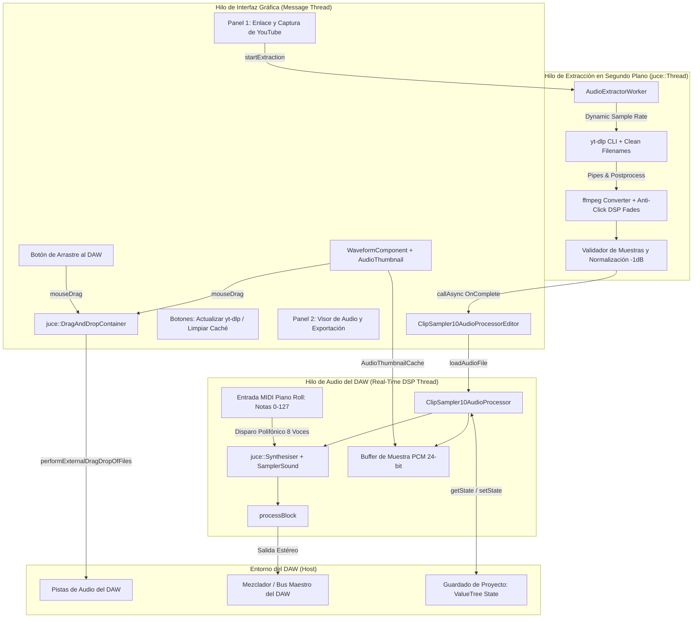

# Documentación Técnica Completa: ClipSampler10 (VSTi & AAX)

Bienvenido a la documentación técnica, de arquitectura y de despliegue del plugin de audio **ClipSampler10**. Este documento detalla la estructura interna, las decisiones de diseño DSP, el funcionamiento multihilo, la integración con DAWs, los scripts de automatización y los procedimientos de compilación e instalación.

---

## 1. Introducción y Propósito del Proyecto

**ClipSampler10** es un instrumento virtual multiplataforma (Windows 10/11 64-bit y macOS Universal Binary) desarrollado sobre el framework **JUCE (v7/v8)** y **CMake**.

Su objetivo principal es permitir a productores musicales, diseñadores de sonido y beatmakers extraer fragmentos de audio de alta fidelidad con un **límite estricto e infranqueable de 10 segundos** directamente desde enlaces de YouTube, previsualizarlos en sincronía con el motor de audio del DAW y arrastrarlos directamente a la línea de tiempo o dispararlos melódicamente vía MIDI en el Piano Roll.

---

## 2. Diagrama de Arquitectura del Sistema



---

## 3. Especificaciones y Mejoras Clave Implementadas

| Característica | Implementación Técnica | Impacto en Producción |
| :--- | :--- | :--- |
| **Sincronización de Sample Rate** | `AudioExtractorWorker` consulta `processor.getSampleRate()` y pasa dinámicamente `-ar <DAW_SR>` a `ffmpeg`. | Cero remuestreos innecesarios en el DAW; fidelidad prístina a 44.1k, 48k, 96k o 192k. |
| **Filtros Anti-Click y Normalización** | Micro-fades DSP de 10ms al inicio y al final (`afade=t=in:ss=0:d=0.01,afade=t=out:st=9.99:d=0.01`) y normalización a -1 dB. | Eliminación total de pops, clicks o saltos de DC al reproducir o loopear el fragmento de 10 segundos. |
| **Sampler Instrumental MIDI** | Integración nativa de `juce::Synthesiser` con `juce::SamplerSound` y 8 voces `juce::SamplerVoice`. | El usuario puede tocar la muestra melódicamente desde el Piano Roll del DAW o teclado controlador MIDI. |
| **Nombres de Archivo Limpios** | `yt-dlp --restrict-filenames -o "%(title).40s_%(section_start)s.%(ext)s"`. | Al arrastrar al DAW, la pista muestra el nombre real del video y el segundo extraído, no códigos genéricos. |
| **Persistencia DAW con ValueTree** | `getStateInformation` y `setStateInformation` serializan `lastUrl`, `lastStartTime` y `lastWavPath` en XML/ValueTree. | Al reabrir el proyecto del DAW, la URL, segundo y muestra cargada se restauran automáticamente. |
| **Mantenimiento Integrado** | Botón para ejecutar `yt-dlp -U` en segundo plano y botón de limpieza de archivos `.wav` de caché. | Garantiza que el motor de descarga nunca quede obsoleto y el disco no se sature de temporales. |

---

## 4. Estructura de Directorios del Repositorio

```text
ClipSampler10/
├── CMakeLists.txt                         # Configuración CMake (JUCE 8, IS_SYNTH, LTO, VST3 y AAX)
├── README.md                              # Resumen y guía rápida de uso
├── documentacion.md                       # Documentación técnica completa y arquitectura
├── analicis.md                            # Informe de auditoría de calidad y arquitectura
├── build_windows.ps1                      # Script automatizado de 1 clic para compilar y empaquetar en Windows
├── Source/
│   ├── DSP/
│   │   ├── PluginProcessor.h              # Núcleo DSP, juce::Synthesiser MIDI, APVTS y coordinador
│   │   └── PluginProcessor.cpp            # processBlock wait-free (ScopedTryLock) y persistencia
│   ├── Services/
│   │   ├── AudioExtractorWorker.h         # Motor asíncrono de extracción (juce::Thread)
│   │   └── AudioExtractorWorker.cpp       # yt-dlp dinámico, anti-click de 1 pasada y updater con timeout
│   └── UI/
│       ├── PluginEditor.h                 # GUI de 2 paneles desacoplada con SafePointer
│       ├── PluginEditor.cpp               # Sincronización de estado a 30 FPS y drag dual
│       ├── WaveformComponent.h            # Visor de audio interactivo (AudioThumbnail)
│       └── WaveformComponent.cpp          # Renderizado de forma de onda, badge dinámico y drag al DAW
├── installer/
│   ├── license.txt                        # Políticas de usuario y EULA (Fair Use & Copyright Disclaimer)
│   ├── windows_installer.iss              # Script Inno Setup con menú exclusivo VST3 y AAX
│   ├── macos_distribution.xml             # Distribution XML para productbuild (macOS)
│   └── build_pkg.sh                       # Script de empaquetado para macOS
└── resources/
    ├── README.md                          # Instrucciones para binarios auxiliares
    └── tools/                             # Directorio para binarios portátiles yt-dlp y ffmpeg
```

---

## 5. Desglose Módulo por Módulo (C++)

### 5.1. Núcleo DSP e Instrumento MIDI: `ClipSampler10AudioProcessor`
- **Archivos:** [`Source/PluginProcessor.h`](file:///c:/Users/joncl/Downloads/Plugin/Source/PluginProcessor.h) y [`Source/PluginProcessor.cpp`](file:///c:/Users/joncl/Downloads/Plugin/Source/PluginProcessor.cpp).
- **Rol:** Gestiona el sintetizador sampler polifónico, buses estéreo y persistencia de proyecto.
- **Detalles Clave:**
  - **Motor `juce::Synthesiser`:** Configurado con 8 voces de polifonía (`juce::SamplerVoice`). Al cargar la muestra extraída, se genera un `juce::SamplerSound` que cubre todo el rango MIDI (notas 0 a 127 con nota raíz C3 / 60).
  - **Sincronización de Procesamiento en `processBlock`:** Invoca `sampler.renderNextBlock(buffer, midiMessages, ...)` permitiendo disparo inmediato desde el piano roll, y suma la reproducción lock-free cuando el usuario pulsa Play en la GUI.
  - **Persistencia de Sesión con `juce::ValueTree`:** En `getStateInformation` serializa `lastUrl`, `lastStartTime` y `lastWavPath`. En `setStateInformation` recupera los datos y recarga el audio automáticamente al abrir el DAW.

### 5.2. Motor Asíncrono de Extracción: `AudioExtractorWorker`
- **Archivos:** [`Source/AudioExtractorWorker.h`](file:///c:/Users/joncl/Downloads/Plugin/Source/AudioExtractorWorker.h) y [`Source/AudioExtractorWorker.cpp`](file:///c:/Users/joncl/Downloads/Plugin/Source/AudioExtractorWorker.cpp).
- **Rol:** Descarga el segmento solicitado de 10 segundos con sincronización de frecuencia de muestreo y anti-click.
- **Detalles Clave:**
  - **Sincronización Dinámica con el DAW:** Toma `currentDawRate` y añade `-ar <DAW_SR>` tanto a `ffmpeg` como a la cabecera WAV final.
  - **Filtros Anti-Click y Normalización:**
    - Cadena de filtros ffmpeg: `afade=t=in:ss=0:d=0.01,afade=t=out:st=9.99:d=0.01` (micro-fade de 10ms al inicio y al final).
    - Post-procesamiento DSP adicional en C++: Si el audio excede `10.0 * sampleRate`, se trunca en memoria y se normaliza el pico a -1 dB (amplitud ~0.891).
  - **Nombres de Archivo Limpios:** Usa `--restrict-filenames` y la plantilla `%(title).40s_%(section_start)s.%(ext)s`.
  - **Routines de Mantenimiento:** Métodos estáticos `runYtDlpUpdate()` para ejecutar `yt-dlp -U` y `clearCacheDirectory()` para vaciar temporales.

### 5.3. Visor Gráfico y Drag-and-Drop: `WaveformComponent`
- **Archivos:** [`Source/WaveformComponent.h`](file:///c:/Users/joncl/Downloads/Plugin/Source/WaveformComponent.h) y [`Source/WaveformComponent.cpp`](file:///c:/Users/joncl/Downloads/Plugin/Source/WaveformComponent.cpp).
- **Rol:** Dibuja la forma de onda de la muestra, la aguja de reproducción (*playhead*) y gestiona el arrastre directo hacia el DAW.
- **Detalles Clave:**
  - Renderizado acelerado por pico con `juce::AudioThumbnail`.
  - Guías visuales cada 2.5s y badge informativo con frecuencia y profundidad de bits (PCM 24-bit).
  - Interacción táctil de arrastre hacia el DAW (`mouseDrag`).

### 5.4. Interfaz Gráfica: `ClipSampler10AudioProcessorEditor`
- **Archivos:** [`Source/PluginEditor.h`](file:///c:/Users/joncl/Downloads/Plugin/Source/PluginEditor.h) y [`Source/PluginEditor.cpp`](file:///c:/Users/joncl/Downloads/Plugin/Source/PluginEditor.cpp).
- **Rol:** Panel dual de usuario con botones de mantenimiento.
- **Distribución de la GUI:**
  1. **Barra Superior de Cabecera:**
     - Logotipo e información del plugin.
     - Botón `Actualizar yt-dlp (-U)`.
     - Botón `Limpiar Caché`.
  2. **Panel Superior (Enlace y Captura):**
     - Campo de texto `urlEditor` con botón `pasteButton`.
     - Campo `startTimeEditor` (`MM:SS`, por defecto `00:00`).
     - Badge de bloqueo estricto: `DURACIÓN MÁXIMA: 10s EXACTOS [BLOQUEADO]`.
     - Botón de acción principal: `Extraer Muestra de 10s`.
     - Barra de progreso y etiqueta de estado descriptiva.
  3. **Panel Inferior (Visor de Audio y Exportación):**
     - Componente de forma de onda interactivo.
     - Botones `Play en DAW` y `Detener`.
     - Botón `Arrastrar al DAW (Timeline / Pista)` con soporte dual (clic y arrastre).
     - Botón `Exportar .WAV...` con `juce::FileChooser` asíncrono.

---

## 6. Procedimientos de Compilación y Empaquetado

### Compilación Rápida Automatizada en Windows (1 Clic)
Ejecuta el script PowerShell incluido:
```powershell
cd "c:\Users\joncl\Downloads\Plugin"
.\build_windows.ps1
```

### Compilación Manual en Windows (MSVC 2022)
```powershell
cmake -B build -G "Visual Studio 17 2022" -A x64
cmake --build build --config Release
iscc installer\windows_installer.iss
```

### Compilación en macOS (Universal Binary)
```bash
cmake -B build -G Xcode -DCMAKE_OSX_ARCHITECTURES="arm64;x86_64" -DCMAKE_OSX_DEPLOYMENT_TARGET="10.13"
cmake --build build --config Release
chmod +x installer/build_pkg.sh
./installer/build_pkg.sh
```

---

## 7. Políticas de Usuario y Licencia (EULA)

El archivo [`installer/license.txt`](file:///c:/Users/joncl/Downloads/Plugin/installer/license.txt) está integrado en los instaladores de Windows e Inno Setup mediante `LicenseFile=license.txt` y en macOS mediante `<license file="license.txt" />`.

- **Aceptación Obligatoria:** El usuario debe aceptar los términos antes de continuar la instalación.
- **Aviso Legal de Derechos de Autor (Fair Use):** Exonera al desarrollador de responsabilidades por contenidos descargados por el usuario final y exige el cumplimiento de las normativas de propiedad intelectual para obras comerciales.
